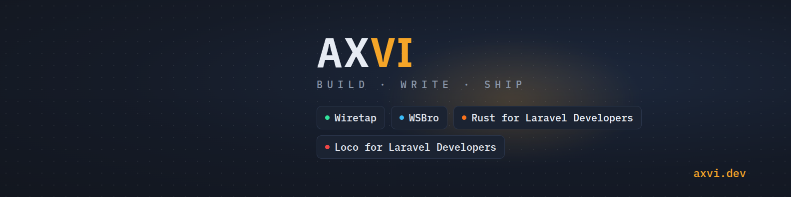
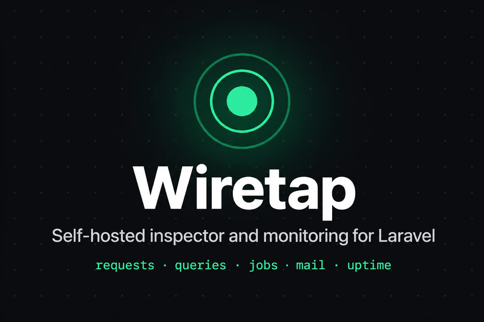
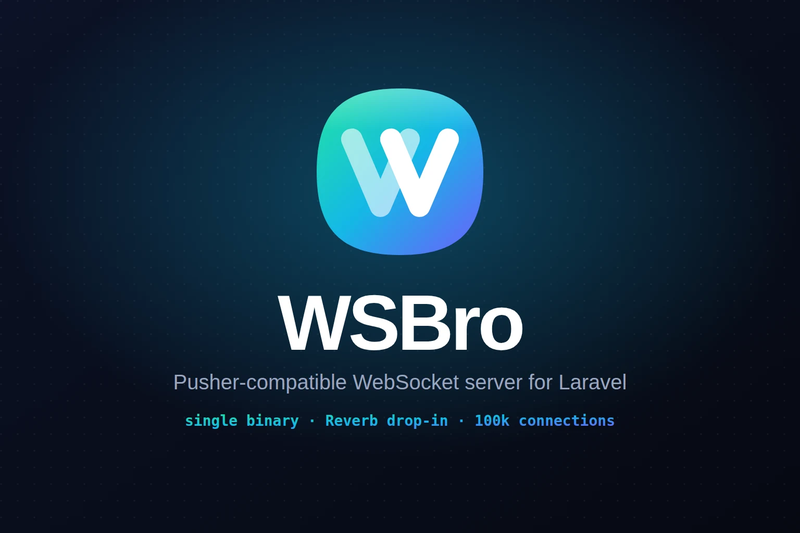
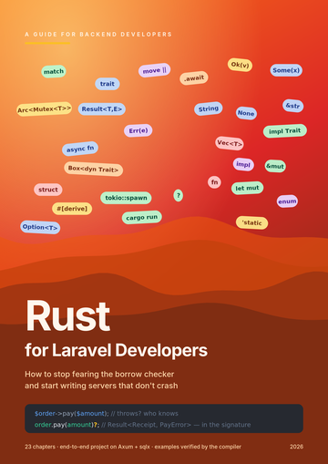
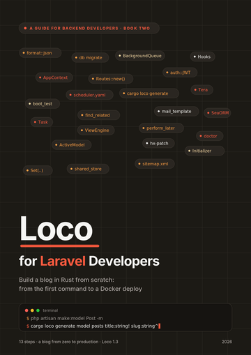

### Hi, I'm Vitaly 👋

I used to program machines that make steel. Now I build tools for Laravel developers.

12 years in industrial automation, 7 years of Laravel. I like boring, reliable software
that keeps running when nobody is watching.

### 🛠 What I build

<table>
  <tr>
    <td width="50%" valign="top">
      
       <b><a href="https://github.com/axvilab/wiretap">Wiretap</a></b>
       Self-hosted inspector and monitoring for Laravel: request traces, N+1 detection, jobs,
      a mail catcher and uptime checks in one Docker image.
    </td>
    <td width="50%" valign="top">
      
       <b><a href="https://github.com/axvilab/wsbro">WSBro</a></b>
       Pusher-compatible WebSocket server in Go. A drop-in for Laravel broadcasting,
      one 20 MB binary with a live dashboard.
    </td>
  </tr>
</table>

Also: [**laravel-maintenance**](https://github.com/axvilab/laravel-maintenance), advanced maintenance mode
for Laravel. Everything lives in [@axvilab](https://github.com/axvilab).

### 📚 Books

<table>
  <tr>
    <td width="160" valign="top">
      
    </td>
    <td valign="top">
      <b><a href="https://leanpub.com/rust-for-laravel-developers">Rust for Laravel Developers</a></b>
       How to stop fearing the borrow checker. Every concept starts from the PHP you'd write,
      then the Rust, then why. 23 chapters, an end-to-end project on Axum and sqlx.
       <a href="https://github.com/axvilab/rust-for-laravel-devs">Companion code</a>
    </td>
  </tr>
  <tr>
    <td width="160" valign="top">
      
    </td>
    <td valign="top">
      <b><a href="https://leanpub.com/loco-for-laravel-developers">Loco for Laravel Developers</a></b>
       A complete blog in Rust in 13 steps, from the first command to a Docker deploy,
      each step compared with the Laravel way.
       <a href="https://github.com/axvilab/loco-for-laravel-devs">Companion code</a>
    </td>
  </tr>
</table>

### 🧰 Stack

### 📫 Where to find me

